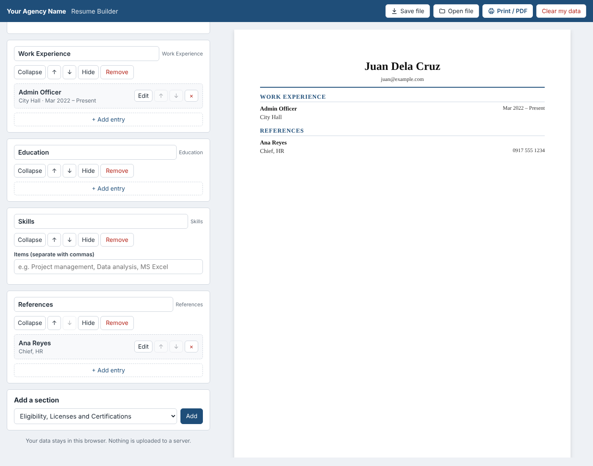

# Resume Builder

A customizable resume builder that government agencies can adopt with no server, database or build step.



## Features

- **Profiles:** start from a preset order of the standard sections (experienced professional, fresh graduate, career shifter, government applicant).
- **Standard sections first:** every resume starts with Summary, Work Experience, Education and Skills. Other sections (eligibility, trainings, awards, references and more) are under **Add a section**, which only lists sections not already on the resume.
- **Editable sections:** add, remove, rename, reorder, hide and show any section, including custom sections.
- **Validated entries:** each entry is added through a form with required fields, month/year date pickers, a "Present" option, and checks for date order, numbers and contact details. An entry reaches the resume only when it passes.
- **Live preview:** A4 layout set in IBM Plex Serif, bundled so it works offline. Ligatures are off so ATS software extracts clean text from the PDF.
- **Latin honors:** Cum Laude, Magna Cum Laude or Summa Cum Laude, shown in bold italic beside the degree.
- **Print / PDF:** uses the browser's print dialog ("Save as PDF").
- **Save / open:** export the resume as a `.json` file and reopen it later on any device.
- **Privacy:** all data stays in the user's browser (autosaved to local storage). Nothing is uploaded.

## Run it

Open `index.html` in a browser. That's it.

To host it, copy `index.html`, `styles.css`, `app.js`, `config.js` and the `fonts/` folder to any static web host (agency web server, GitHub Pages, intranet).

## Adopt it for your agency

Edit `config.js` only:

| Setting | What it controls |
|---|---|
| `agency` | Name, tagline, brand color, privacy note |
| `personalFields` | Identity and contact fields collected |
| `sectionTypes` | Section building blocks and their fields |
| `profiles` | Preset layouts per user type |

## Project structure

```
index.html   Page layout
styles.css   Editor and resume styling, print rules
app.js       Editor logic, preview rendering, save/load
config.js    Agency configuration (the file adopters edit)
fonts/       IBM Plex Serif, the resume typeface (SIL Open Font License)
```

## Known limitations

- Not a replacement for the CSC Personal Data Sheet (CS Form 212), which has a fixed official format.
- Local storage autosave is per browser. On shared or kiosk computers, users should click **Clear my data** when done.
- Single resume template (layout style). Additional templates are on the roadmap.
